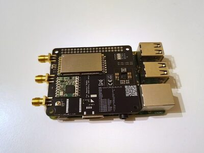
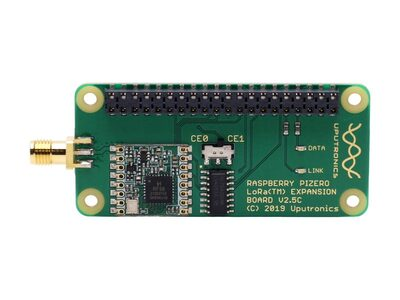
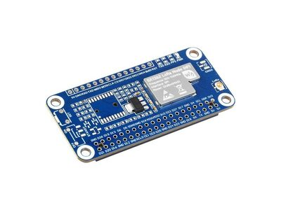
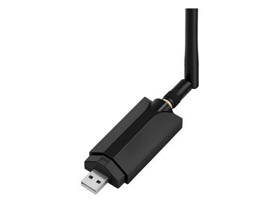
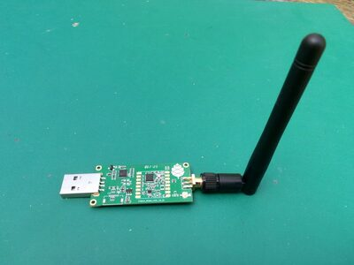
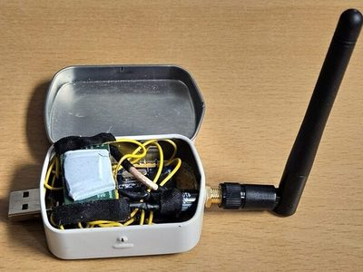

# LoRaHAM_Daemon - Device Driver

*Deutsch: [README.de.md](README.de.md)*

**LoRaHAM_Daemon is the hardware driver for LoRa radios on Linux.** It owns the radio chip and
exposes it on UNIX sockets, so an application can send, receive and configure the radio without
touching the hardware itself — LoRa on single-board computers and PCs, for amateur radio.

The daemon was originally written by Alexander Walter for the LoRaHAM_Pi HAT and has been
refactored and extended by makrohard. It drives SX1276, SX1278 and SX1262 radio chips, wired
directly to the SPI bus or behind a USB-to-SPI bridge. Other boards should work too, given a `--hw`
preset whose wiring matches.

## Contents

* [Hardware](#hardware)
* [Three ways to run it](#three-ways-to-run-it)
* [Write your own client](#write-your-own-client)
* [Warnings](#warnings)
* [Credits and license](#credits-and-license)

## Hardware

* Raspberry Pi 3/4/5 and Zero 2 W, Raspbian image — or an x86 Linux PC with one of the USB sticks below
* SPI enabled with the `spi0-0cs` overlay — [how](docs/hardware.md)
* 433 MHz and 868 MHz, one daemon process per band; 915 untested

Supported radio boards, selected with `--hw`:

| `--hw` | Board |
|---|---|
| `loraham` | **[LoRaHAM_Pi HAT / LoRaHAM Cartridge](https://www.loraham.de/produkt/loraham-pi/)** — the [LoRaHAM project's](https://loraham.de) own dual-module board, SX1278 for 433 MHz + RFM95 for 868 MHz |
| `uputronics-ce0`, `uputronics-ce1` | [Uputronics Raspberry Pi Zero LoRa Expansion Board](https://store.uputronics.com) — RFM95/RFM98; one board for a single band, or two stacked for dual-band. The preset picks the chip select and pins, not the band: `--radio` decides that, so either board can serve either band |
| `waveshare-sx1262` | [Waveshare SX1262 LoRaWAN/GNSS HAT](https://www.waveshare.com/wiki/SX1262_XXXM_LoRaWAN/GNSS_HAT) — 433M and 868M variants. **SPI only**: the daemon drives the SX1262 chip directly, so the HAT's GNSS receiver is unused and this is not a LoRaWAN gateway or concentrator setup. No FSK streaming and no board LED on this board, and it cannot be combined with an Uputronics board — the pins collide |
| `meshstick-1262` | [ELECROW Meshstick](https://www.elecrow.com/meshstick-usb-to-spi-sx1262-tcxo-lora-usb-stick-usb-plug-and-play-meshtastic-lora-mesh-node.html) — SX1262 on USB (CH341 USB-to-SPI bridge), 868 (or 915 on its 915 variant). Needs the optional Meshstick library built with the daemon (pine64 libch341-spi-userspace); uses no Pi GPIO. See [Hardware](docs/hardware.md#elecrow-meshstick-usb) |
| `pinedio-usb-1262` | PINE64 USB LoRa adapter — SX1262 on the same CH341 bridge, 868 (or 915 on its 915 variant); the same library. See [Hardware](docs/hardware.md#other-usb-sticks-on-the-ch341) |
| `ch341-rfm98pw-433` | A CH341A board wired to a HopeRF RFM98PW — SX127x on USB, 433 only; the same library. See [Hardware](docs/hardware.md#other-usb-sticks-on-the-ch341) |

Any HAT whose radio is an **SX1276**, **SX1278** or **SX1262** wired directly to the Pi's SPI bus
should work — pick the preset whose wiring matches. Wiring, capability flags, the combination
matrix and how to add a board are in [`docs/hardware.md`](docs/hardware.md).

## Three ways to run it

### With LoRaHAM_Pi Control

**[LoRaHAM_Pi Control (LHPC)](https://github.com/makrohard/loraham-pi-control) installs and runs
all of this for you**, from a web UI, on a box you flash and forget. There are
**[ready-made SD-card images](https://github.com/makrohard/loraham-images)** — flash one, boot,
open the web UI, pick your hardware and start a stack. It builds the daemon from this repository,
pins it to a tested commit, and manages the radios, the sockets and the systemd units.

The nine stacks it can run:

| Stack | What it is |
|---|---|
| LoRaHAM daemon | the daemon on its own, one process per band |
| LoRaHAM Chat | the APRS/chat TUI from [`clients/`](clients/), on 433 |
| LoRaHAM Voice | Codec2 voice over LoRa, GTK on a desktop or ncurses on a Lite box |
| LoRaHAM KISS TNC | KISS/TCP TNC on port 8001 for APRS clients, optional serial PTY |
| Graywolf APRS | APRS station with web UI, digipeater and iGate, through the KISS TNC |
| Meshtastic | native `meshtasticd` on the RF95, run rootless |
| MeshCom | MeshCom firmware under QEMU, bridged to the daemon |
| MeshCore | MeshCore on openHop, 868, chat node and/or repeater |
| Reticulum | RNS node driving the radio directly over SPI |

### Build the daemon yourself

[`loraham_daemon/`](loraham_daemon/) is the tree under active development: one process per band,
instance and GPIO locks, CAD/LBT, a framed DATA protocol, systemd units and a test suite. Build and
run it in three commands — [`loraham_daemon/README.md`](loraham_daemon/README.md).

The reference documentation is in [`docs/`](docs/):

| | |
|---|---|
| [Hardware](docs/hardware.md) | Packages, RadioLib, SPI, board presets, wiring, two boards on one Pi |
| [Deployment](docs/deployment.md) | systemd, users and groups, sockets on disk, locks, exit codes |
| [Command line](docs/cli.md) | Every flag, and the RF settings each band starts with |
| [CONF protocol](docs/conf-protocol.md) | Configuring the radio at runtime: commands, parameters, queries, replies |
| [DATA protocol](docs/data-protocol.md) | The raw and framed wire formats |
| [Limits and timing](docs/limits.md) | Sizes, timeouts, TX modes, CAD behaviour |
| [Architecture](docs/architecture.md) | Module map and runtime design |
| [Examples](docs/examples.md) | Short programs that talk to the daemon, in shell, Python and C |
| [Soak test](docs/soak-test-2026-09-16.md) | Four hours, four instances, both bands: the sustained-load evidence behind the 1.0.0 pin |

### Archived: daemons and example clients

[`archive/`](archive/) holds the single-file daemons, both bands in one process. They remain
available and buildable, and [`archive/README.md`](archive/README.md) has everything needed to do
it: prerequisites, RadioLib, the compile lines and how to run them.

Chat and voice are the clients that ship (run by LoRaHAM_Pi Control; the source of the
[chat TUI](clients/chat/README.md) is in [`clients/`](clients/)). The rest of `clients/` — the
[APRS iGate](clients/igate/README.md), dual-band RSSI bars and a Meshtastic decryptor — are archived
examples. Start the daemon first, then a client.

Working on the code: [`CONTRIBUTING.md`](CONTRIBUTING.md).

## Write your own client

The daemon is a device driver with a socket interface, which means anything that can open a UNIX
socket can drive the radio — no SPI, no RadioLib, no C required unless you want it.

[**Examples**](docs/examples.md) has the shortest programs that do something real: ask the daemon
how it is with one line of `socat`, transmit from a shell one-liner, then receive and transmit in
Python, C and JavaScript. Every command and program on that page was run against a real daemon on
real hardware, and the outputs shown are what came back.

Start there, change the payload, and watch `GET CHANNEL` while you move an antenna.

## Warnings

This code is provided at your own risk and responsibility.

* Some frequencies (433 MHz) are licensed amateur radio frequencies: you need a ham licence, and
  encryption is not allowed.
* On licence-free frequencies (868 MHz in the EU) you must keep the power and duty-cycle limits.
* You are responsible for complying with the local radio rules.

## Credits and license

    Copyright (c) 2020-2026 Alexander Walter
    refactored by makrohard Johannes Loose 410733@gmail.com
    Licensed under the GNU GPL v3 (see LICENSE)
